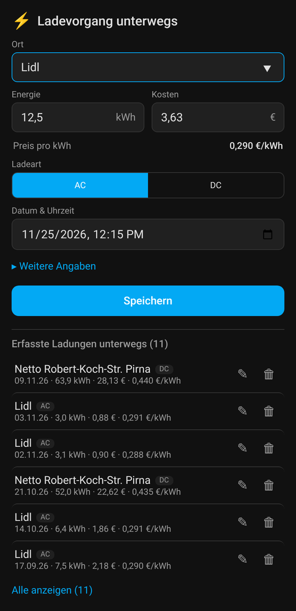

# EV Charge Log (EV-Ladebuch) for Home Assistant

Note - this ist the First test Version. I‘m allready work on it!

Combines the charging sessions **evcc** records at home with the sessions you charge
**elsewhere** (public chargers, supermarket, work …) and turns them into statistics:
cost, average price per kWh, consumption, and a comparison against a combustion car.

## Features

- Reads all sessions from the evcc REST API (`/api/sessions`): energy, price, odometer, solar share
- Takes the odometer from evcc (`/api/state`) – no car integration needed
- Action `ev_charge_log.add_session` to log public charging (location, kWh, price, date,
  odometer, charge time, waiting time, AC/DC, note); stored in Home Assistant
- Actions to update, delete and list sessions (`list_sessions` returns all sessions + monthly overview)
- 30 sensors, e.g.
  - energy total / at home / public / this month / this year
  - cost total / at home / public / this month / this year
  - average price per kWh (total / home / public)
  - distance, odometer, consumption kWh/100 km
  - cost of a comparable fuel car, savings (total / month / year), cost per 100 km
  - solar share at home, waiting and charging time on public chargers
  - last session (attribute `sessions`: last 25 sessions) and monthly overview (attribute `months`)
- Fuel price either fixed or from any sensor (e.g. Tankerkönig)

Sessions where evcc has no price are costed with the average home price.

## Installation

### HACS
1. HACS → ⋮ → Custom repositories → add this repository as type *Integration*
2. Install **EV Charge Log**, restart Home Assistant

### Manual
Copy `custom_components/ev_charge_log` into your `config/custom_components` folder and restart.

## Setup

Settings → Devices & services → Add integration → **EV Charge Log**

Setup has three steps:

1. **evcc** – URL of evcc (e.g. `http://49686a9f-evcc:7070` for the evcc app, or `http://<ip>:7070`), or switch evcc off to log every session manually.
2. **Vehicle** – name (prefilled from evcc, free to change), which evcc vehicle names belong to this car
   (evcc names can change over time – select all of them), usable battery capacity, WLTP consumption and an
   optional odometer sensor (needed without evcc).
3. **Comparison car** – diesel or petrol, l/100 km, fuel price (fixed or a sensor, e.g. Tankerkönig),
   odometer at handover and the CO₂ value used for public charging (g/kWh).

Several cars? Add the integration once per car and pick the matching evcc vehicle. The form card then shows a vehicle selector.

New in 0.3: CO₂ of the EV and of the comparison car, CO₂ savings, deviation from WLTP, real range on a full battery.

## Form card

The integration ships a dashboard card and loads it automatically – no resource to add:

```yaml
type: custom:ev-charge-log-card
title: Ladevorgang unterwegs   # optional
show_list: true                # optional, list of logged sessions with edit/delete
list_limit: 10                 # optional
default_charge_type: DC        # optional
```



## Logging a public charging session via action

```yaml
action: ev_charge_log.add_session
data:
  location: Lidl Pirna
  energy: 23.44
  cost: 10.32
  duration: 25
  waiting_time: 5
  charge_type: DC
```

Without `date` the session is logged *now* and gets the last odometer evcc reported.
Tip: wrap the action in a script with fields – the script's more-info dialog is then a
ready-made input form for your dashboard.
